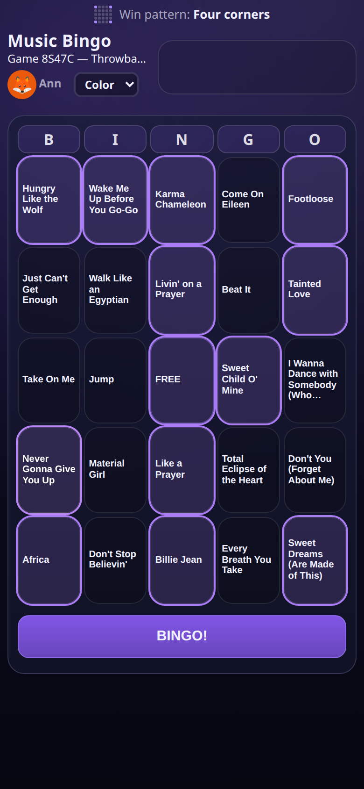
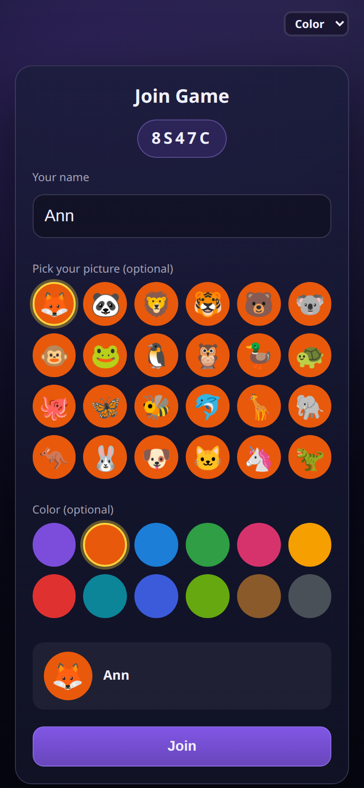
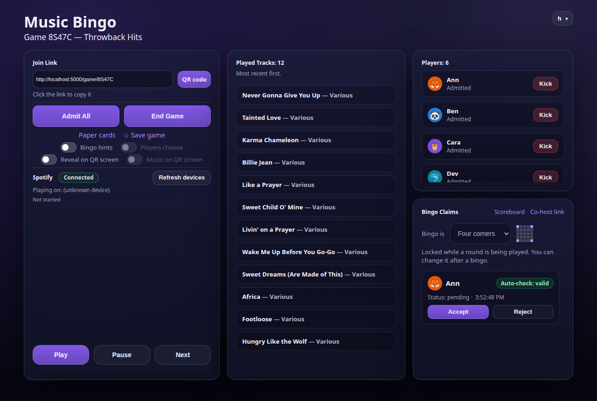
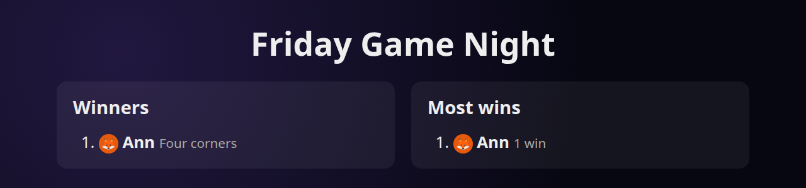

# Music Bingo

A web-based music bingo game. A host plays songs from a Spotify playlist, and players mark the song titles on
their cards, on their phones or on printed paper cards. The host checks each bingo claim.

Built with FastAPI, Jinja templates, SQLAlchemy and Postgres, and run with Docker. Live updates use WebSockets,
and music plays through the Spotify Web Playback SDK.

There is a built-in **Getting Started** page at `/help` (also in the host menu) that explains how to use the app.

<p align="center">
  
  &nbsp;&nbsp;
  
</p>
<p align="center">
  
</p>

The host runs the game from one page (above); players join on their phones by scanning a QR code or typing the game code. After a
win, the scoreboard shows who won and how many rounds each player has taken:

<p align="center">
  
</p>

## Features

**Hosting**
- Host accounts with login; an admin page to create accounts and reset passwords
- Create a game from a Spotify playlist; players join with a game code or link
- Admit players, start the game, play, pause and skip from the host page (embedded browser player or another Spotify device)
- Live Played Tracks list and Bingo Claims with accept or reject, then Continue playing (optionally with the Full card) or End Game
- Rounds and a **scoreboard** screen to cast to a TV, a **QR screen** for joining (and a song-reveal mode for the room), and a **co-host link** so a second person can accept or reject claims on their own phone
- Bingo hints (the column letter lights up as each song starts), seven color themes and your own custom colors
- Saved playlists, kept private or shared with other hosts; Spotify-made playlists are refused up front
- Each host connects their own Spotify account

**Players**
- Join on a phone with a name, an animal picture and a color; each player gets a different card of song titles
- Choose what counts as bingo: any line, four corners, X, plus, a frame or the full card, and change it between rounds
- A **Color / Light / Dark** display switch for readability (Light and Dark are plain, with no theme colors)
- Songs are revealed a few seconds into each track; tap squares and call Bingo
- Solo mode: play alone against your own Spotify queue

**Paper cards**
- Up to 100 printable cards per game, one per US Letter or A4 page, with numbers and check codes
- Optional event name or logo in the center square (events are saved per host)
- Optional join footer with a QR code and web address
- Cards in one game are never identical and avoid sharing winning lines, across paper and phone cards
- Type a card's check code to see the card and which squares have played, then accept or reject the bingo
- Make more cards, update only the cards with removed songs, or regenerate all of them

**Saved games**
- Save a game, then **Play again** keeps the game code, playlist, event and paper cards and clears the session

## Quick start

You need a computer or server with [Docker](https://docs.docker.com/get-docker/) (Compose v2 included). On Windows, install
[Docker Desktop](https://www.docker.com/products/docker-desktop/) and run the commands below in its WSL (Ubuntu) window, or install Docker
Engine inside WSL. The first start builds or downloads the app, which takes a minute or two.

```bash
git clone https://github.com/kmax9981/music-bingo.git && cd music-bingo
./run.sh
```

(You only need `docker-compose.yml` and `run.sh`; the app image is downloaded for you, or built from this folder if it can't be.) `run.sh` makes a private `.env`
with a random database password, starts the app and its database, and prints the address.

**Prefer one file?** `docker-compose.yml` also works on its own: `docker compose up -d`, or paste it into Portainer, Dockge,
Unraid or a Synology stack. The database sits on a private network that only the app can reach (no published port, no
internet), so it needs no extra secret.

Then finish in your browser. Open the address it printed (http://127.0.0.1:5000). Until the first account exists every
page shows the **setup screen**:
1. Create the admin account with a username and password of your choice.
2. Enter your public address and your Spotify developer app's client ID and secret. Create the Spotify app at
   https://developer.spotify.com/dashboard; the setup screen shows the redirect URI to register. You can skip this and add
   it later on the Admin page.

Then create host accounts for other people on the Admin page (menu, top right). Every secret the app needs is made for you:
the database password by `run.sh`, the cookie secret by the app itself (kept in its data volume).

To update, `git pull` (or download the new files) and run `./run.sh` again. Your data is kept in Docker volumes.
For real use put a reverse proxy with HTTPS in front of port 5000 (nginx, Caddy, Cloudflare Tunnel, ...). Optional
settings (port, public address, Spotify app, ...) can go in `.env`: see `.env.example`.

### Trying it on your own computer (no domain)

You don't need a domain to try it at home. This is what Spotify's rules allow, as far as we know (check Spotify's developer
documentation, it changes):
- Register `http://127.0.0.1:5000/auth/spotify/callback` as the redirect URI in your Spotify app. Spotify accepts a plain
  `http://` redirect only for the loopback address `127.0.0.1` (not the name `localhost`); anything else must be `https://`.
- As the host, open the app at `http://127.0.0.1:5000` on that computer (not `localhost` or the network address). Browsers
  only play protected (DRM) audio such as Spotify's on secure pages, and `127.0.0.1` counts as one.
- Phones can't reach `127.0.0.1` on your computer. Put your computer's network address (for example
  `http://192.168.1.20:5000`) as the **public address** so join links and QR codes work, and give the Spotify redirect
  address separately (the setup screen and the Admin page both have a box for it). The phones must be on the same Wi-Fi.
- A second device that plays the music (the QR screen's room speaker) needs an `https://` address, for the same browser
  reason. Plain `http://` over the network is unencrypted, which is fine at home but not for the internet.

Things to know about Spotify (from Spotify's developer documentation; it changes, so check it):
- Each host needs **Spotify Premium** to play music in the browser (the Web Playback SDK requires it), and the owner of the
  Spotify developer app must have Premium too.
- A Spotify developer app starts in "Development Mode": **at most 5 people** can connect to it, and each one's Spotify email
  must be added to the app's user list in the developer dashboard first. "Extended quota" (unlimited users) is only
  available to registered organizations with a large launched service, so plan for a small group of hosts per install.
- Redirect URIs must be `https://`, except `http://127.0.0.1:PORT` (or `http://[::1]:PORT`) for loopback; `localhost` is not accepted.
- Spotify-made playlists (Today's Top Hits, Daily Mix, ...) can't be read by apps; hosts save a copy to their own library.

### Spotify and personal use

Use Music Bingo for **private, non-commercial** play with family and friends: at home, not as a public or business
service. Spotify's Developer Policy lists things apps must not do, including creating games, playing music publicly from a
business, and webcasting. Whether a private music bingo counts as a "game" under that policy has not been confirmed with
Spotify, so **using it is at your own risk**. Spotify can change its rules or limit a developer app at any time. You, not
the author, are responsible for following Spotify's terms. Read the current policy at https://developer.spotify.com/policy.

| Setting (in `.env`) | Used for |
| --- | --- |
| `DB_PASSWORD` | Made by `run.sh`: the database password |
| `BINGO_PORT` | The port on this machine (default 5000) |
| `PUBLIC_BASE_URL` | Optional (the setup screen asks): the public address, used in join links, QR codes and Spotify redirects |
| `SPOTIFY_CLIENT_ID`, `SPOTIFY_CLIENT_SECRET`, `SPOTIFY_REDIRECT_URI` | Optional (the setup screen and Admin page take them): your Spotify developer app |
| `HOST_ADMIN_PASSWORD` | Optional, for unattended installs: creates the admin account from this password instead of showing the setup screen |
| `COOKIE_SECRET` | Optional: normally made by the app. Signs session cookies and paper-card check codes (changing it invalidates printed cards) |
| `TRUST_PROXY_HEADERS` | `true` (default) when a proxy such as Cloudflare sets the visitor's address; `false` if the app is reachable directly |

Back up before every update: see [Backing up, restoring and updating](docs/BACKUP_AND_UPDATE.md). Database changes are applied
automatically when the app starts.

To work on the code, change the files in `app/` and run `docker compose up -d --build` to rebuild the image from your folder.

## More guides

- [Putting it on the internet with HTTPS](docs/HTTPS.md): Caddy, nginx or a Cloudflare Tunnel in front of the app
- [Backing up, restoring and updating](docs/BACKUP_AND_UPDATE.md)
- [What data it keeps](docs/PRIVACY.md), and how to delete it
- [Locked out of every account?](docs/README_PASSWORD_RESET.md)

## How many players?

One small server is enough. Measured on a single CPU core with the real database (`tests/load_test.sh`, 500 phones connected,
all joining at the same moment, which is much harsher than a real evening):

| Players | Everyone joined | A song change reaches every phone | Peak CPU / memory |
| --- | --- | --- | --- |
| 60 | 1 s | under 0.1 s | 61% / 100 MB |
| 300 | 10 s | under 0.1 s | 81% / 135 MB |
| 500 (the most one game allows) | 24 s | under 0.1 s | 86% / 165 MB |

In a real room people arrive over minutes, so joining is instant. Every connected phone keeps one socket open, so the app
needs a high open-files limit: `docker-compose.yml` sets it (many hosts only allow containers 1,024 files, which runs out around
450 players). If you run the container some other way, give it `--ulimit nofile=65536:65536`.

## License

Music Bingo is **source-available for noncommercial use**, under the
[PolyForm Noncommercial License 1.0.0](LICENSE.md). You can run it, change it and share it for personal use and other
noncommercial purposes (for example at home, with friends and family, or for a hobby, school or charity event).
**Commercial use is not allowed**, including running it as part of a paid service or business.

Commercial use needs a separate license: contact the author through the GitHub profile named in the LICENSE.md file.

This is not an open-source licence in the OSI sense, because it limits commercial use.

Music Bingo is an independent project and is **not made, endorsed or sponsored by Spotify**. Using Spotify through it is subject
to Spotify's own terms and developer policy. Third-party components are listed in `THIRD_PARTY_NOTICES.md`.

## Layout

| Path | What is there |
| --- | --- |
| `app/main.py` | Creates the app (security middleware, static files) and includes the route modules |
| `app/routes/` | The pages and endpoints, one module per area: `home`, `auth` (login, account, admin users), `solo` (Play Alone), `player` (join, card, bingo claims, live socket), `host_games` (dashboard, create/save/reset/delete, events), `game_live` (the live game page, players, start/end), `game_playback` (play, pause, next, song updates), `game_claims`, `playlist_pages`, `spotify_account`, `paper_pages` |
| `app/common.py`, `app/state.py` | Shared web plumbing (templates, cookies, host login, game ownership) and per-game live state |
| `app/cards.py`, `app/playlists.py`, `app/paper.py`, `app/claims.py` | Helpers the routes share: building and checking cards, saved playlists and clean copies, paper cards, bingo claim notices |
| `app/migrations.py` | Creates tables and applies the numbered schema changes (recorded in a `schema_migrations` table) when the app starts |
| `app/setup_flow.py`, `app/routes/setup.py`, `app/settings.py` | The first-run setup screen (admin account) and the settings an admin can save in the app (public address, Spotify app) |
| `app/csrf.py`, `app/http_headers.py`, `app/login_guard.py`, `app/passwords.py`, `app/reset_password.py` | Security: CSRF, headers and CSP, login throttling, password hashing and the shell reset tool |
| `app/models.py`, `app/db.py` | Database models and connection |
| `app/spotify.py` | Spotify API and token handling |
| `app/ws.py` | WebSocket hub for live updates |
| `app/security.py`, `app/util.py` | Cookie signing and small helpers |
| `app/templates/` | Jinja pages (host, player, paper cards, help). Pages that need server values give their script a small `window.BINGO_HOST` / `BINGO_PLAYER` / `BINGO_SOLO` object (game code, status, ...) |
| `app/static/` | CSS and browser scripts: `app.css` (shared styles), one script per big page (`host_game.js`, `player_card.js`, `play_solo.js`, `solo_reveal.js`), `bingo_hint.js` (shared hint logic), the vendored `qrcode.js` |
| `app/static/pages/` | Small per-page scripts and styles, one file per block that used to sit inside a template. Bump the `?v=` number in the template when you change one, so browsers fetch it again |
| `docs/` | Operations notes |

## Branches and releases

- `dev` is where work happens and is tested; `main` is what gets released.
- The tests are browser tests that run against a throwaway copy of the app: `tests/run_tests.sh` (see the top of that file
  for what it needs). Run them before every release.
- Always back up the database before updating a running install.

## Security notes

- Never commit `.env`, `config-bingo.env` or other secrets (they are in `.gitignore`).
- Game codes are letters and digits only, and error messages are HTML-escaped.
- Only a game's owner can change its state; players act through their own per-game cookie.
- The paper-card check codes are keyed with `COOKIE_SECRET`, so keep that value stable.
